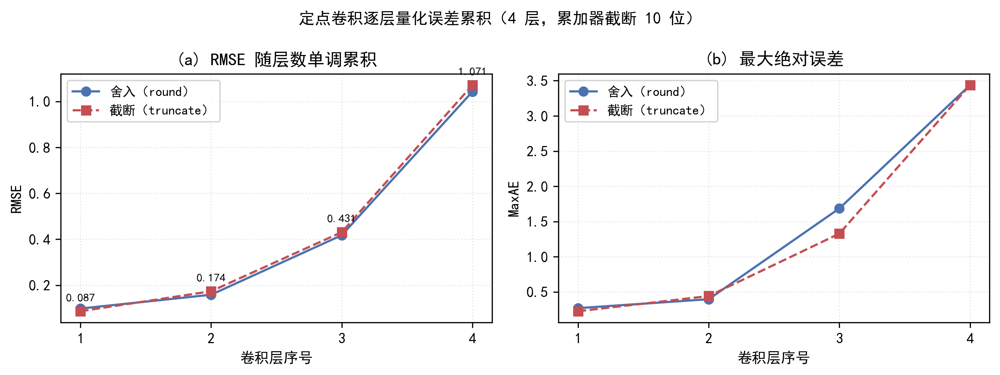
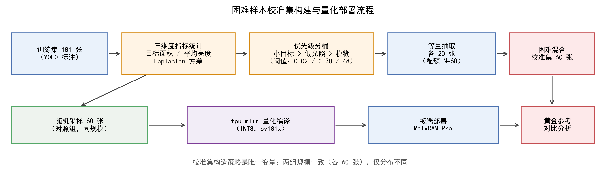
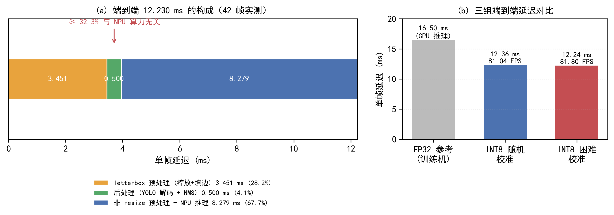
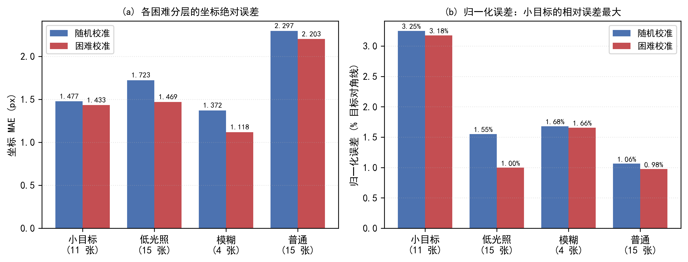
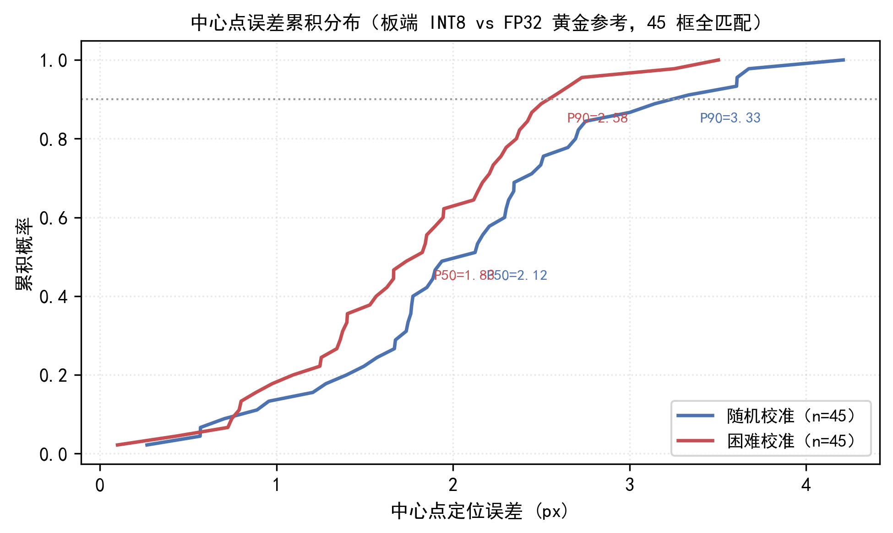
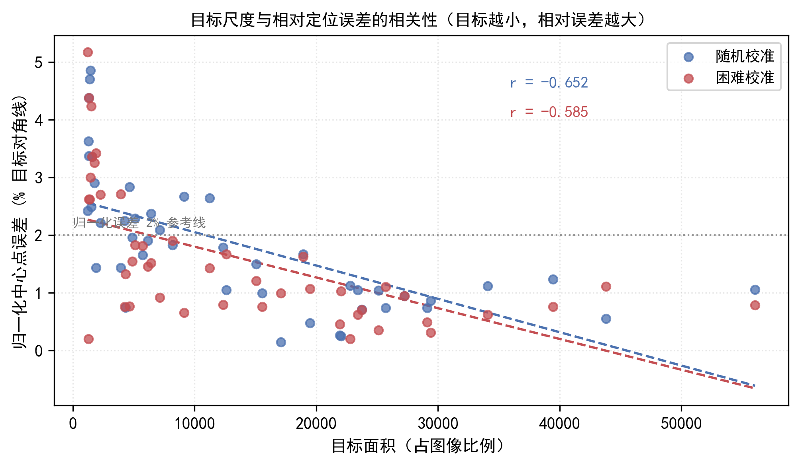
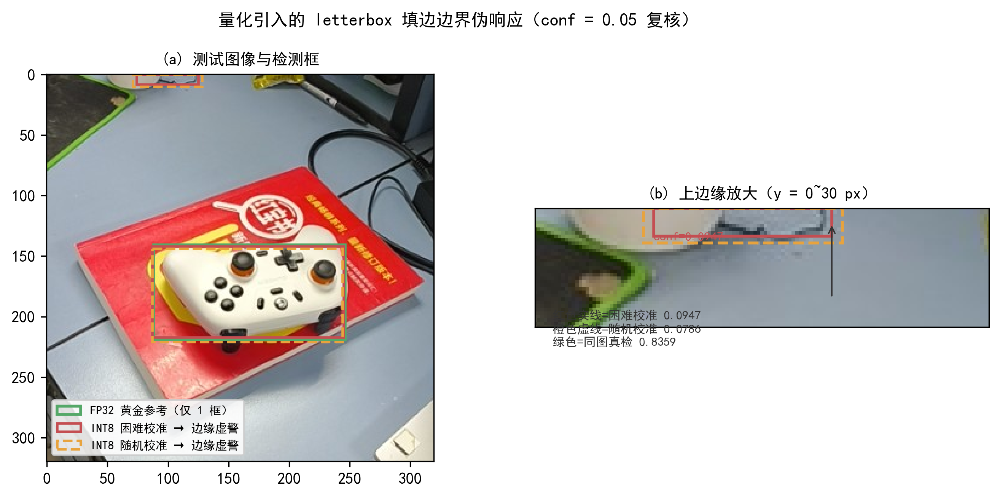

# 面向边缘 NPU 部署的 YOLO11-n 困难样本校准集构建及量化误差机理分析

> 一个完整的「目标检测 → INT8 训练后量化 → 板端部署 → 量化误差分析」工程研究项目。
> 在真实边缘硬件 **MaixCAM-Pro**（SG2002，1 TOPS INT8 NPU）上完成端到端验证。

**作者**：【姓名】何臻博 ｜ **论文状态**：未发表（全文见私有仓库，本仓库只公开代码与结果）
**大陆邮箱**：18978900496@163.com
---

## 一句话简介

针对边缘 NPU 上 INT8 训练后量化（PTQ）精度回退问题，提出**困难样本导向的校准集构建方法**（按「小目标 / 低光照 / 模糊」三维度分桶等量抽样），并建立基于 **FP32 黄金参考** 的张量级量化误差分析框架；在 MaixCAM-Pro 上实测验证：困难样本校准相对随机校准将检测框坐标 MAE 降低 **8.2%**、MaxAE 降低 **14.3%**，且**不增加任何部署开销**。

---

## 背景与问题

将深度学习目标检测模型部署到低算力边缘设备时，INT8 量化是压缩模型、加速推理的关键手段。但训练后量化用一小批「校准集」统计各层激活值动态范围，**官方默认从训练集随机采样**，难以覆盖小目标、低光照、模糊等困难样本的激活分布，导致量化截断误差在困难样本上被放大。

## 方法

1. **困难样本三维度筛选**：以「归一化目标面积 / 图像平均亮度 / Laplacian 方差」三个维度对训练样本分桶，按优先级（小目标 > 低光照 > 模糊）等量抽取，构成困难混合校准集；对照组为同规模随机校准集（各 60 张，仅分布不同）。
2. **黄金参考误差分析**：以 Windows 端 ONNXRuntime 的 FP32 输出为黄金参考，对板端 INT8 输出做逐框 IoU 匹配，计算坐标 MAE / MaxAE / RMSE / 超阈值占比 / 中心点误差 / 归一化误差 / 置信度偏差，并按困难类型分层。
3. **板端延迟分解**：针对固件不暴露子步骤（C++ 内置类）的限制，用「输入尺寸 A/B 对照 + 通用推理接口对照」把端到端延迟拆成 letterbox 预处理 / 后处理 / 推理三段。

> 完整实验流程、各阶段命令与脚本对应关系见 [EXPERIMENT.md](EXPERIMENT.md)。

## 关键结果

| 指标 | 随机校准 | 困难校准 | 变化 |
| --- | --- | --- | --- |
| 检测框坐标 MAE (px) | 1.823 | **1.674** | **−8.2%** |
| 检测框 MaxAE (px) | 9.77 | **8.37** | **−14.3%** |
| 中心点误差 MAE (px) | 2.082 | **1.762** | **−15.4%** |
| 归一化误差 (% 对角线) | 1.815 | **1.582** | **−12.8%** |
| 匹配 IoU 均值 | 0.9154 | **0.9227** | +0.0073 |

**分层改善**：低光照 −14.7%、模糊 −18.5%、小目标 −3.0%（相对随机校准）。

**板端性能**（MaixCAM-Pro，320×224，dual_buff=False）：

| 组别 | 延迟(ms) | FPS | 模型大小(MB) |
| --- | --- | --- | --- |
| INT8 困难校准 | **12.24** | **81.80** | 2.73 |
| INT8 随机校准 | 12.36 | 81.04 | 2.73 |

**端到端延迟构成**（42 帧实测）：letterbox 预处理 **3.451 ms（28.2%）** ＋ 后处理 **≥0.500 ms（≥4.1%）** ＋ 预处理/推理 ≤8.279 ms。

**补充发现**：测试集上三组 mAP 均饱和（AP@0.5 = 100%），说明粗粒度排序指标会掩盖量化差异；把置信度阈值降至 0.05 复核，两组 INT8 各出现 1 个位于 letterbox 填边区域的边缘虚警（FP32 无），查准率 97.83%。

### 结果图

| 定点卷积误差累积 | 校准集构建流程 | 延迟构成 |
| --- | --- | --- |
|  |  |  |

| 分层误差 | 中心点误差 CDF | 尺度相关性 | 边缘虚警 |
| --- | --- | --- | --- |
|  |  |  |  |

---

## 目录结构

```
edge-npu-yolo-quantization/
├── README.md                本文件
├── EXPERIMENT.md            实验流程与方法（8 阶段管线）
├── LICENSE                  MIT
├── figures/                 7 张结果图（由 make_figures.py 生成）
└── code/                    实验脚本
    ├── screen_hard_samples.py    困难样本三维度筛选
    ├── random_calib.py           随机校准集（对照组）
    ├── analyze_dataset.py        数据集统计与分桶
    ├── voc2yolo.py               VOC → YOLO 标注转换
    ├── quant_demo.py             定点卷积逐层量化误差演示（表 2-1）
    ├── board_collect.py          板端采集（延迟/FPS/资源/检测框）
    ├── board_analysis.py         黄金参考 + 量化误差 + mAP 分析
    ├── board_latency_breakdown.py 端到端延迟三段分解
    ├── board_probe_api.py        板端固件 API 探针
    ├── make_mud.py               生成 MaixPy 模型描述文件（INI）
    ├── make_figures.py           结果图生成
    └── ...                       其余辅助脚本
```

## 复现说明

> ⚠️ 本仓库为**方法复现参考**，脚本中的文件路径（`D:\maixcam_exp\...`、`/root/...`）与硬件/环境强相关，使用前请按你的目录修改。

- **训练**：Ultralytics `8.4.104`，YOLO11-n，训练 `imgsz=320`，导出 `imgsz=224,320`（高×宽）、`opset=17`、`dynamic=False`。
- **量化**：TPU-MLIR（`sophgo/tpuc_dev`），`model_transform` 固定 `mean=0,0,0`、`scale=1/255`、`pixel_format=rgb`、`pad_value=114`，输出裁剪至 dfl/Conv 与 Sigmoid，`model_deploy --quantize INT8 --processor cv181x`。
- **板端**：MaixCAM-Pro，MaixPy v4.10.3；部署格式为 INI 的 `.mud` + `.cvimodel`，后处理 API 为 `nn.YOLO11`。
- **黄金参考**：ONNXRuntime + `imgsz=(224,320)` + `conf=0.25 / iou=0.45`。

## 技术栈

`Python` · `Ultralytics YOLO11` · `ONNXRuntime` · `TPU-MLIR` · `MaixPy` · `OpenCV` · `numpy` · `python-docx` · `matplotlib`

## 论文全文与数据

- **论文全文（未发表）** 与**原始数据集、模型权重**保存在私有仓库中，暂不公开。
- 本仓库仅包含代码与结果图，用于展示方法与成果。

## License

本项目代码采用 [MIT License](LICENSE)。结果图与论文版权归作者所有，引用请注明出处。
